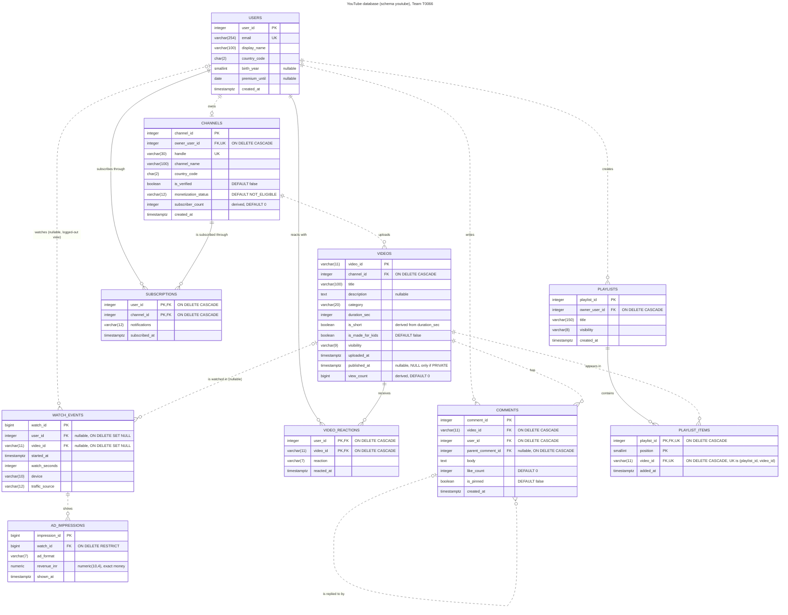

# Phase 2: Schema Design

Team T0066 | PostgreSQL 18.6

## How we worked out the schema

The project provided the 10 CSV files but no table definitions, so the schema had to be derived from the data itself. As a first step, every file was loaded into a scratch database with all columns stored as plain text. Each column was then profiled for the number of empty values, the number of distinct values, the minimum and maximum length, the minimum and maximum value, and the complete set of values where only a few existed. Following this, we examined candidate keys (whether any column or combination of columns repeats), referential links between tables (whether every identifier refers to an existing row), and the business rules stated in the README. Every data type and constraint described below is based on this analysis of the actual data.

Everything is in the schema `youtube`. The files are `sql/01_schema.sql` and `sql/02_load_data.sql`.

## Data dictionary

### users (30,000 rows)

| Column | Type | Constraints | Why |
|---|---|---|---|
| user_id | integer | PK | Up to 30,000 now and about 600,000 in the large data. integer goes up to 2.1 billion. |
| email | varchar(254) | NOT NULL, UNIQUE, CHECK format | 254 is the max length of an email address. Two accounts can't share an email, so it's a candidate key. |
| display_name | varchar(100) | NOT NULL | Not unique, 30,000 users share 500 names. |
| country_code | char(2) | NOT NULL, CHECK `^[A-Z]{2}$` | Always exactly 2 capital letters. We used a pattern instead of a fixed list because new countries will show up. |
| birth_year | smallint | nullable, CHECK 1900 to 2026 | Values are 1960 to 2009 so 2 bytes is enough. Empty for 4,433 users who didn't share it. |
| premium_until | date | nullable | The file has a date with no time. Empty for 27,602 users who never had Premium. R25 compares it with `shown_at::date`. |
| created_at | timestamptz | NOT NULL | Every timestamp has a +05:30 offset, timestamptz keeps the exact moment. |

### channels (3,000 rows)

| Column | Type | Constraints | Why |
|---|---|---|---|
| channel_id | integer | PK | |
| owner_user_id | integer | NOT NULL, UNIQUE, FK users ON DELETE CASCADE | No user owns two channels in the data, so we made it 1:1. Deleting an account deletes its channel, like YouTube. |
| handle | varchar(30) | NOT NULL, UNIQUE, CHECK `^@[a-z0-9._]+$` | The public @name, must be unique. 10 to 19 characters in the data. |
| channel_name | varchar(100) | NOT NULL | Not unique, only 200 different names. |
| country_code | char(2) | NOT NULL, CHECK | Same rule as users. |
| is_verified | boolean | NOT NULL, DEFAULT false | The file uses t/f. A new channel starts unverified. |
| monetization_status | varchar(12) | NOT NULL, DEFAULT 'NOT_ELIGIBLE', CHECK in 3 values | ELIGIBLE, NOT_ELIGIBLE, SUSPENDED. A new channel doesn't earn yet. |
| subscriber_count | integer | NOT NULL, DEFAULT 0, CHECK >= 0 | Derived from subscriptions. See the normal form section. |
| created_at | timestamptz | NOT NULL | |

### videos (30,000 rows)

| Column | Type | Constraints | Why |
|---|---|---|---|
| video_id | varchar(11) | PK, CHECK `^[A-Za-z0-9_-]{11}$` | Looks like random text, not a number. Always exactly 11 characters and case sensitive. |
| channel_id | integer | NOT NULL, FK channels ON DELETE CASCADE | Delete a channel and its videos go too. |
| title | varchar(100) | NOT NULL, CHECK not blank | |
| description | text | nullable | Empty for 9,083 videos with no pattern by category or visibility, so it's just optional. W01 also leaves it out. |
| category | varchar(20) | NOT NULL, CHECK in 10 values | Comedy, Cooking, Education, Film, Gaming, Music, News, Sports, Tech, Vlogs. |
| duration_sec | integer | NOT NULL, CHECK > 0 | 10 to 3,718 seconds. |
| is_short | boolean | NOT NULL, CHECK `is_short = (duration_sec <= 60)` | Shorts are 10 to 59 seconds, other videos are 120 seconds or more. The CHECK stops the two from disagreeing. |
| is_made_for_kids | boolean | NOT NULL, DEFAULT false | W01 doesn't give a value, without the default it would fail. |
| visibility | varchar(9) | NOT NULL, CHECK in 4 values | PUBLIC, UNLISTED, PRIVATE, SCHEDULED. |
| uploaded_at | timestamptz | NOT NULL | |
| published_at | timestamptz | nullable, CHECK `(visibility = 'PRIVATE') = (published_at IS NULL)`, CHECK `published_at >= uploaded_at` | Empty for exactly the 1,526 private videos and nothing else. Scheduled videos have a future date (2 to 21 July 2026). |
| view_count | bigint | NOT NULL, DEFAULT 0, CHECK >= 0 | Derived from watch_events. bigint because real view counts reach billions. W01 needs the default. |

### subscriptions (129,253 rows)

| Column | Type | Constraints | Why |
|---|---|---|---|
| user_id | integer | PK part, FK users ON DELETE CASCADE | |
| channel_id | integer | PK part, FK channels ON DELETE CASCADE | |
| notifications | varchar(12) | NOT NULL, CHECK ALL / PERSONALIZED / NONE | The bell setting. |
| subscribed_at | timestamptz | NOT NULL | |

The file has no id column. A row just means "this user follows this channel", so the key is the pair (user_id, channel_id). Neither column is unique alone but the pair never repeats, you can't subscribe twice.

### watch_events (200,000 rows)

| Column | Type | Constraints | Why |
|---|---|---|---|
| watch_id | bigint | PK | Biggest and fastest growing table. W02 inserts 90,000,001 and the data will grow 20x. |
| user_id | integer | nullable, FK users ON DELETE SET NULL | Empty for 49,964 views (about 25%), these are logged-out viewers. |
| video_id | varchar(11) | nullable, FK videos ON DELETE SET NULL | Never empty in the data. We allow NULL only so that deleting a video keeps its views. |
| started_at | timestamptz | NOT NULL | |
| watch_seconds | integer | NOT NULL, CHECK >= 0 | 458 rows are exactly 0, so `> 0` would have failed the load. |
| device | varchar(10) | NOT NULL, CHECK ANDROID / IOS / WEB / TV | |
| traffic_source | varchar(12) | NOT NULL, CHECK in 6 values | HOME, SUGGESTED, SEARCH, SUBSCRIPTION, SHORTS_FEED, EXTERNAL. |

### video_reactions (67,417 rows)

| Column | Type | Constraints | Why |
|---|---|---|---|
| user_id | integer | PK part, FK users CASCADE | |
| video_id | varchar(11) | PK part, FK videos CASCADE | |
| reaction | varchar(7) | NOT NULL, CHECK LIKE / DISLIKE | |
| reacted_at | timestamptz | NOT NULL | |

Key is (user_id, video_id). One person can only like or dislike a video once, same as YouTube.

### comments (60,000 rows)

| Column | Type | Constraints | Why |
|---|---|---|---|
| comment_id | integer | PK | |
| video_id | varchar(11) | NOT NULL, FK videos CASCADE | |
| user_id | integer | NOT NULL, FK users CASCADE | |
| parent_comment_id | integer | nullable, FK comments CASCADE, CHECK <> comment_id | Empty for 52,610 top-level comments. A reply points at its parent, so the table points at itself. Deleting a comment deletes its replies. |
| body | text | NOT NULL, CHECK not blank | |
| like_count | integer | NOT NULL, DEFAULT 0, CHECK >= 0 | |
| is_pinned | boolean | NOT NULL, DEFAULT false, CHECK `NOT (is_pinned AND parent_comment_id IS NOT NULL)` | Only top-level comments can be pinned. All 6,974 pinned comments are top level. |
| created_at | timestamptz | NOT NULL | |

### playlists (8,000 rows)

| Column | Type | Constraints | Why |
|---|---|---|---|
| playlist_id | integer | PK | |
| owner_user_id | integer | NOT NULL, FK users CASCADE | |
| title | varchar(150) | NOT NULL | Not unique per owner. Two users have two playlists with the same name, so a UNIQUE would fail the load. |
| visibility | varchar(8) | NOT NULL, CHECK PUBLIC / UNLISTED / PRIVATE | No SCHEDULED for playlists. |
| created_at | timestamptz | NOT NULL | |

### playlist_items (56,005 rows)

| Column | Type | Constraints | Why |
|---|---|---|---|
| playlist_id | integer | PK part, FK playlists CASCADE | |
| position | smallint | PK part, CHECK >= 1 | 1 to 12 in the data. |
| video_id | varchar(11) | NOT NULL, FK videos CASCADE, UNIQUE with playlist_id | The same video is never in a playlist twice. |
| added_at | timestamptz | NOT NULL | |

This table has two candidate keys, (playlist_id, position) and (playlist_id, video_id). We picked the first as the PK because R21 reads a playlist in order, and made the second UNIQUE.

### ad_impressions (57,014 rows)

| Column | Type | Constraints | Why |
|---|---|---|---|
| impression_id | bigint | PK | About 1.14 million rows in the large data and growing. |
| watch_id | bigint | NOT NULL, FK watch_events ON DELETE RESTRICT | Revenue records should never disappear by accident. |
| ad_format | varchar(7) | NOT NULL, CHECK PREROLL / MIDROLL | |
| revenue_inr | numeric(10,4) | NOT NULL, CHECK > 0 | Money is never stored as float because floats round. The data always has 4 decimals (0.1750 to 0.8250). |
| shown_at | timestamptz | NOT NULL | |

## Why some columns are empty

| Column | Empty rows | Reason |
|---|---:|---|
| watch_events.user_id | 49,964 | The viewer was not signed in. |
| videos.published_at | 1,526 | Exactly the PRIVATE videos. A private video is never published. |
| users.premium_until | 27,602 | The user never had Premium. |
| users.birth_year | 4,433 | The user didn't share their age. |
| videos.description | 9,083 | The creator left it blank. No pattern by category or visibility. |
| comments.parent_comment_id | 52,610 | Top-level comment, not a reply. |

Every other column is NOT NULL because no row in the data is empty there and the business needs a value.

A small detail we used on purpose: a CHECK only rejects a row when the condition is false. If the condition is NULL the row passes. So `birth_year BETWEEN 1900 AND 2026` still allows a missing birth year, and `published_at >= uploaded_at` still allows private videos.

## Keys and delete rules

We wanted deletes to work like YouTube. When an account or channel is deleted on YouTube, its content is gone for good. But views and money that already happened stay in the platform totals.

| Foreign key | ON DELETE | Reason |
|---|---|---|
| channels.owner_user_id → users | CASCADE | Delete the account, the channel goes. |
| videos.channel_id → channels | CASCADE | Delete the channel, its videos go. |
| subscriptions → users, channels | CASCADE | A subscription means nothing without both sides. |
| video_reactions → users, videos | CASCADE | Same. |
| comments → users, videos | CASCADE | Content is removed with its owner or video. |
| comments.parent_comment_id → comments | CASCADE | Deleting a comment deletes the whole reply thread. |
| playlists.owner_user_id → users | CASCADE | |
| playlist_items → playlists, videos | CASCADE | A deleted video leaves a gap in the playlist positions, YouTube shows "deleted video" there. |
| watch_events.user_id → users | SET NULL | The view still counts, it just stops pointing at a person. It then looks like a logged-out view in R12. |
| watch_events.video_id → videos | SET NULL | Platform totals (R12, R20) and ad revenue stay correct. The cost is we lose the guarantee that every view has a video. |
| ad_impressions.watch_id → watch_events | RESTRICT | Money records must never vanish. Deleting users or videos only sets NULL on watch_events, never deletes them, so this RESTRICT is never hit by a cascade. |

Cardinalities:
- users to channels is 1:1 (UNIQUE owner_user_id)
- channels to videos is 1:N
- users to channels through subscriptions is M:N
- users to videos through video_reactions is M:N
- playlists to videos through playlist_items is M:N
- users to watch_events is 0..1 to N (a view may have no user)
- watch_events to ad_impressions is 1:N
- comments to comments is 1:N (replies)

## ER diagram

For zooming, open the vector version [er_diagram.svg](../diagrams/er_diagram.svg), which stays sharp at any size.

The diagram uses crow's foot notation (Information Engineering).

| Symbol | Meaning |
|---|---|
| `\|\|` | exactly one |
| `\|o` / `o\|` | zero or one |
| `o{` / `}o` | zero or many |
| Solid line | identifying relationship, the foreign key is part of the child's primary key (subscriptions, video_reactions, playlist_items) |
| Dashed line | non-identifying relationship, the child has its own primary key |
| PK / FK / UK | primary key, foreign key, unique key |

Every column is NOT NULL unless it is marked nullable. Each foreign key also shows its ON DELETE rule.

Mermaid source (also in `diagrams/er_diagram.mmd`):

## Functional dependencies and normal form

| Table | Functional dependencies | Normal form |
|---|---|---|
| users | user_id → all columns. email → all columns (candidate key). | BCNF, both determinants are keys. |
| channels | channel_id → all. handle → all. owner_user_id → all. | BCNF in structure. subscriber_count is derived from another table, see below. |
| videos | video_id → all. duration_sec → is_short. | 3NF is broken by duration_sec → is_short (a non-key column decides another). Kept on purpose, see below. |
| subscriptions | (user_id, channel_id) → notifications, subscribed_at | BCNF |
| watch_events | watch_id → all | BCNF |
| video_reactions | (user_id, video_id) → reaction, reacted_at | BCNF |
| comments | comment_id → all | BCNF |
| playlists | playlist_id → all | BCNF |
| playlist_items | (playlist_id, position) → video_id, added_at. (playlist_id, video_id) → position, added_at. | BCNF, both determinants are candidate keys. |
| ad_impressions | impression_id → all | BCNF |

We checked for hidden dependencies that would break 3NF, for example country_code doesn't decide anything in channels, and channel_name doesn't decide handle (200 names for 3,000 channels).

### Derived and redundant columns

| Column | Can be calculated from | Matches the real value? | Keep it? |
|---|---|---|---|
| channels.subscriber_count | count of subscriptions per channel | Yes, all 3,000 channels match exactly | Yes. R02 shows it on every watch page and counting subscriptions each time would be slow. W04 recomputes it every night. |
| videos.view_count | count of watch_events per video | Yes, all 30,000 videos match exactly | Yes. R01 and R04 show and sort by it. W03 adds one per view. |
| videos.is_short | duration_sec <= 60 | Yes, 0 mismatches | Yes. It makes R10 simpler, and the CHECK means it can never be wrong. |

So the schema is in BCNF except for these three on purpose, and each one is either protected by a CHECK or refreshed by a known job.

## Indexes that exist after Phase 2

We did not create any index ourselves. PostgreSQL made one for every PRIMARY KEY and UNIQUE constraint, 14 in total:

| Table | Index | From |
|---|---|---|
| users | pk_users, uq_users_email | PK, UNIQUE |
| channels | pk_channels, uq_channels_handle, uq_channels_owner | PK, UNIQUE, UNIQUE |
| videos | pk_videos | PK |
| subscriptions | pk_subscriptions (user_id, channel_id) | PK |
| watch_events | pk_watch_events | PK |
| video_reactions | pk_video_reactions (user_id, video_id) | PK |
| comments | pk_comments | PK |
| playlists | pk_playlists | PK |
| playlist_items | pk_playlist_items (playlist_id, position), uq_playlist_items_video (playlist_id, video_id) | PK, UNIQUE |
| ad_impressions | pk_ad_impressions | PK |

Important for later: there is no index on any foreign key column. So for example `watch_events.video_id`, `videos.channel_id` and `subscriptions.channel_id` have no index, and the composite PKs only help when the query filters on their first column. A lot of the slow plans in Phase 3 come from this.

## Load results

`02_load_data.sql` loads the files parents first (users, channels, videos, subscriptions, watch_events, video_reactions, comments, playlists, playlist_items, ad_impressions) and then runs ANALYZE. Comments refer to other comments, but a reply always has a bigger id than its parent and the file is sorted by id, so parents always load first.

Every file loaded on the first try with no rejected rows.

| Table | Loaded | Expected | OK |
|---|---:|---:|:-:|
| users | 30,000 | 30,000 | yes |
| channels | 3,000 | 3,000 | yes |
| videos | 30,000 | 30,000 | yes |
| subscriptions | 129,253 | 129,253 | yes |
| watch_events | 200,000 | 200,000 | yes |
| video_reactions | 67,417 | 67,417 | yes |
| comments | 60,000 | 60,000 | yes |
| playlists | 8,000 | 8,000 | yes |
| playlist_items | 56,005 | 56,005 | yes |
| ad_impressions | 57,014 | 57,014 | yes |

## Integrity checks

These rules go across two tables or across many rows, so a CHECK can't enforce them. We tested them with queries instead. Each query counts the rows that break the rule.

| Check | Violations |
|---|---:|
| A watch is longer than the video | 0 |
| A video was watched before it was uploaded | 0 |
| The same video is in a playlist twice | 0 |
| A playlist has gaps in its positions | 0 |
| An ad was shown outside its watch time | 0 |
| A SHORTS_FEED view is of a non-Short | 0 |
| A reply is on a different video than its parent | 0 |
| A video has more than one pinned comment | 0 |
| Stored subscriber_count is different from the real count | 0 |
| Stored view_count is different from the real count | 0 |

To enforce these in the database later we would need triggers, or for the pinned comment rule a partial unique index, which isn't allowed in this phase.

## Data problems we found

These rows don't break any constraint, so they loaded fine, but they don't make sense for the business. We report them instead of deleting them because changing the data is not allowed, and most of them span two tables so a CHECK can't catch them.

| Problem | Rows | What we think |
|---|---:|---|
| Subscribed before the user account existed | 4,949 | Impossible in real life. Probably a bad export or test data. |
| Subscribed before the channel existed | 1,338 | Same kind of timestamp problem. |
| Channel created before its owner account | 1,415 | Same. |
| Video watched before it was published (public or unlisted) | 2,738 | Could be premieres or creators previewing, but more likely bad timestamps. |
| Ads on NOT_ELIGIBLE or SUSPENDED channels | 36,904 | These channels shouldn't earn money. Partner program should look at this. |
| Ads shown to users with active Premium | 181 | Premium users should never see ads. This is what R25 audits. |
| Comments on made-for-kids videos | 1,007 | Comments must be off on kids videos. This is what R18 finds. |
| Users under 13 when they signed up | 2,189 | YouTube's minimum age is 13. Either fake birth years or a policy problem. |
| Users subscribed to their own channel | 2 | Odd but harmless. |
| Channel with no videos (channel 1574) | 1 | Fine, a channel can be empty. |

## What the data told us that we didn't expect

- `subscriber_count` and `view_count` match the real counts exactly. So W04 (recount subscribers) will update every row but not actually change any value on the seed data.
- R13 returns 0 rows on this schema. That's because of the NULL user_ids in watch_events and the `NOT IN` in the query, which we fix in Phase 4.
